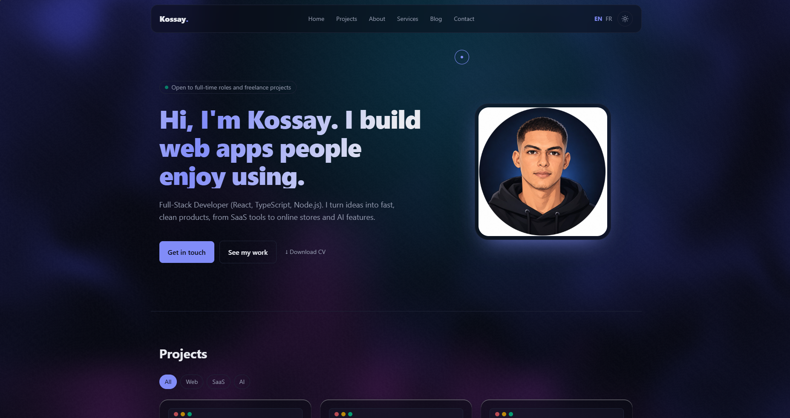

# Kossay | Portfolio

[](https://github.com/kossayokazi/Portfolio/actions/workflows/ci.yml)
[](https://kossay-portfolio.kossayokkazi5678.workers.dev/en/)

Personal portfolio of a full-stack developer, in English and French. Soft-glass design with a WebGL background, case studies, a Markdown blog and a working contact form.



**Live:** https://kossay-portfolio.kossayokkazi5678.workers.dev/en/

## Features

- Bilingual (EN / FR) with per-page titles, canonical URLs and generated social preview images
- Case study pages for each project, plus an MDX blog with reading time and syntax highlighting
- Contact form that sends email through Resend
- WebGL shader background, custom cursor and 3D card tilt, with reduced-motion support
- Dark by default, with a light theme toggle
- Fully static pages, served from Cloudflare Workers

## Stack

| Area | Tools |
|---|---|
| Framework | Next.js 16 (App Router, Turbopack), React 19, TypeScript |
| Styling and motion | Tailwind CSS 4, Framer Motion, raw WebGL (GLSL) |
| Content | MDX (`next-mdx-remote`, `gray-matter`, `rehype-highlight`) |
| Email | Resend |
| Hosting | Cloudflare Workers through OpenNext |

## Getting started

```bash
git clone https://github.com/kossayokazi/Portfolio.git
cd Portfolio
npm install
cp .env.example .env.local   # then fill in the values
npm run dev
```

Open http://localhost:3000, which redirects to `/en/`.

## Environment variables

| Name | Where | Purpose |
|---|---|---|
| `RESEND_API_KEY` | secret (`.env.local` locally, Cloudflare secret in production) | Sends contact form emails |
| `CONTACT_EMAIL` | `wrangler.jsonc` `vars` | Inbox that receives messages |

Never commit `.env.local`. It is gitignored.

## Scripts

| Command | What it does |
|---|---|
| `npm run dev` | Development server |
| `npm run build` | Production build |
| `npm run lint` | ESLint |
| `npm run cf:build` | Build for Cloudflare Workers |
| `npm run cf:preview` | Preview the Workers build locally |
| `npm run cf:deploy` | Deploy to Cloudflare |

## Project structure

```
app/[locale]/     pages, layout, project and blog routes, social preview image
app/api/contact/  contact form endpoint
components/       UI components (Hero, Navbar, Skills, Timeline, GlassBackdrop, Cursor...)
data/             site content in English and French
messages/         UI strings per language
content/blog/     blog posts in MDX
lib/              i18n and blog helpers
```

## Deployment

Every push is built by Cloudflare Workers Builds, and CI (lint, type-check, build) runs on every pull request. To deploy manually:

```bash
npm run cf:build
npm run cf:deploy
```

Set `RESEND_API_KEY` as a secret in the Cloudflare dashboard (Workers, Settings, Variables and Secrets).